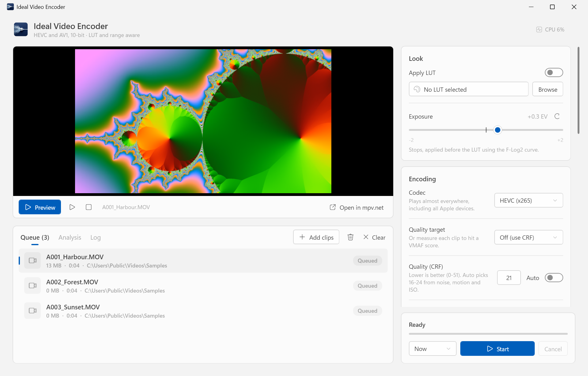
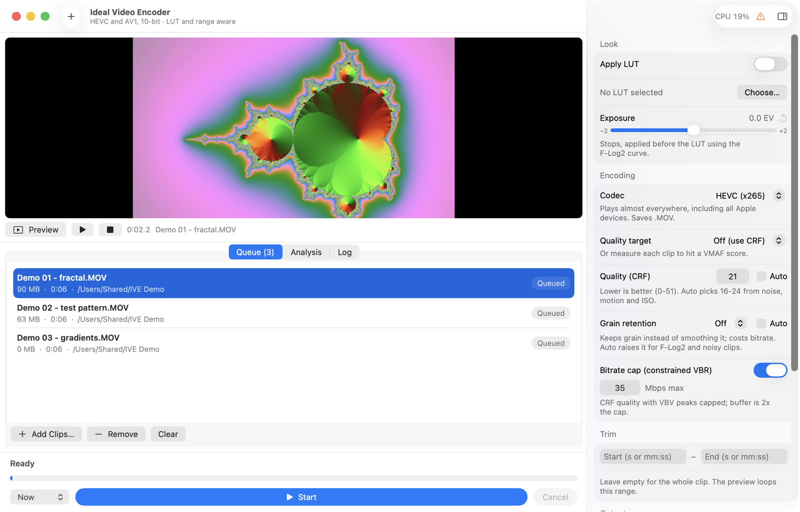
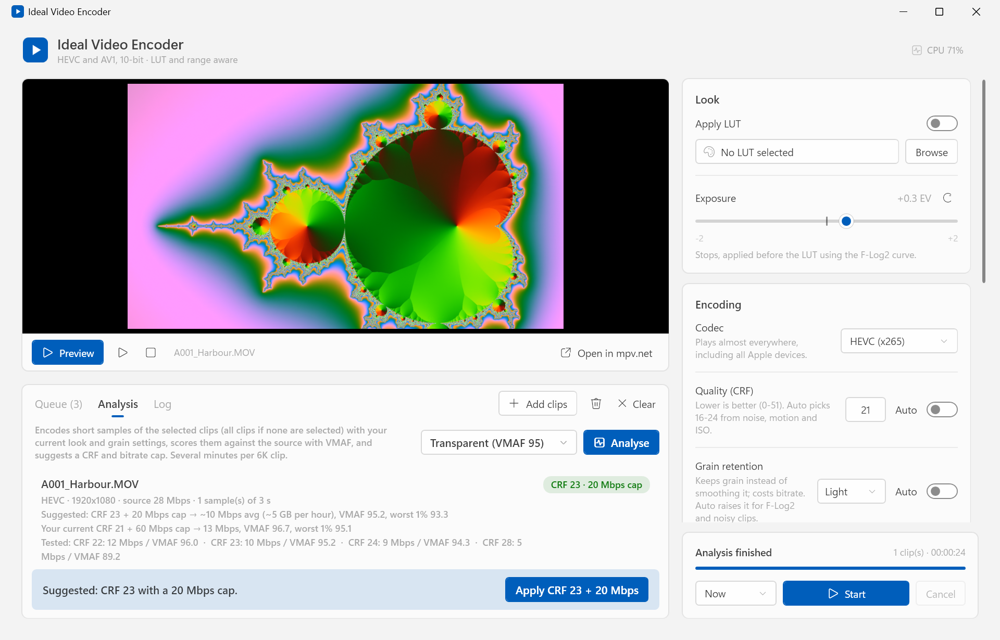

# Ideal Video Encoder

A Windows and Mac app that turns large in-camera video files into compact, high-quality 10-bit HEVC (H.265) or AV1 files — with a live LUT and exposure adjustment preview, a batch queue, full metadata cloning and a built-in analyser that measures your own footage to suggest encoder settings.

It was built around Fujifilm footage (X-H2S 6.2K open gate, X-T5 6.2K/4K, F-Log2) but works with any `.MOV` or `.MP4` that FFmpeg can read. Both versions use the same encoder settings, analyser and settings file format.

| Windows | macOS |
| --- | --- |
|  |  |

## Features

- **Live preview inside the app** (embedded mpv on Windows, AVFoundation on Mac). Exposure, LUT and trim changes update instantly; the preview applies the same look as the final encode.
- **Exposure before the LUT**, in stops, applied in log space at 10-bit precision (calibrated to the F-Log2 curve).
- **3D LUTs (`.cube`)** applied at 10-bit, with correct full-to-limited range handling for full-range camera files.
- **HEVC (x265) or AV1 (SVT-AV1)**, 10-bit, with CRF quality control and an optional **bitrate cap** (constrained VBR) for predictable file sizes.
- **Grain retention** levels (Off / Light / Strong): x265 grain tuning for HEVC, film-grain synthesis for AV1, plus an Auto mode.
- **Settings analyser**: encodes short samples of each clip, scores them against the source with [VMAF](https://github.com/Netflix/vmaf), and finds the CRF and bitrate cap that hit a quality target. Use the result per clip or for everything.
- **Quality target mode**: pick a VMAF score instead of a CRF, and every clip is measured just before it's encoded and gets its own CRF and cap.
- **Speed changes** from 0.125x to 8x (Windows; coming to Mac). Slow motion from high-frame-rate footage (e.g. 120p at 0.25x) is conformed to a normal frame rate so every captured frame is used; other speeds keep the clip's frame rate.
- **Audio control** (Windows; coming to Mac): keep or remove the soundtrack, normalise loudness (two-pass EBU R128 to -16 LUFS), or replace it with a music file that loops if it's shorter than the clip and fades out at the end. The preview plays the result.
- **Batch queue** with per-clip progress, ETA, cancel, a scheduled start at any time you choose (in your computer's time zone, daylight-saving aware) and an optional CSV log.
- **Metadata kept**: capture date, camera, lens, film simulation, GPS and more are copied with ExifTool, including the Apple QuickTime keys that Photos reads for the camera make and model, and file dates are set to the capture time.
- **Flexible output**: next to each source clip or in a chosen folder, with an optional subfolder. Never overwrites a source file.
- **Native on each platform**: a Windows 11 design that follows your light/dark mode and accent colour with per-monitor high-DPI support, and a SwiftUI Mac app with light/dark mode, your accent colour, VoiceOver labels, keyboard shortcuts and adjustable text size.

## Requirements

**Windows**

- Windows 10 or 11 (64-bit)
- [FFmpeg](https://www.gyan.dev/ffmpeg/builds/) **full** build on your `PATH` (needs `libx265`, `libsvtav1`, `zscale` and, for the analyser, `libvmaf`)
- [ExifTool](https://exiftool.org/) on your `PATH` as `exiftool.exe`
- [mpv.net](https://github.com/mpvnet-player/mpv.net) for the preview (installed in the default location, or placed in an `mpv.net` folder next to the app)

The installer can set these up for you (see below).

**macOS**

- macOS 14 Sonoma or later, Apple silicon or Intel
- [Homebrew](https://brew.sh) with FFmpeg and ExifTool:

  ```sh
  brew install ffmpeg exiftool
  ```

Homebrew's standard FFmpeg has everything the Mac app needs (`libx265`, `libsvtav1`, `lut3d`, `lutyuv` and, for the analyser, `libvmaf`). It has no `zscale`; the Mac app uses `zscale` for full-range clips when it is there, as the Windows version does, and FFmpeg's built-in `scale` filter otherwise, which gives the same result to within a fraction of a level. The app can also install what's missing for you (see below).

LUTs are not included; Fujifilm publishes official F-Log/F-Log2 LUTs on its website.

## Getting started

### Windows: install (recommended)

Download **`Ideal-Video-Encoder-Setup-<version>.exe`** from the [Releases](../../releases) page and run it. It installs the app for your user account (no admin rights needed), adds Start menu shortcuts and an uninstaller, and can install any missing prerequisites:

- **FFmpeg** (full build), **ExifTool** and **mpv.net**

Prerequisites already on your `PATH` and complete are left alone. Missing ones are installed per-user with [winget](https://learn.microsoft.com/windows/package-manager/winget/), or downloaded from their official sites (gyan.dev, exiftool.org, mpv.net) if winget isn't available. You can re-run this any time from the Start menu entry **Ideal Video Encoder - Install or repair prerequisites**, or directly:

```powershell
powershell -ExecutionPolicy Bypass -File .\installer\Install-Prerequisites.ps1
```

Uninstalling the app does not remove the prerequisites, since other programs may use them.

### Windows: portable

Alternatively download `Ideal-Video-Encoder.exe` on its own (prerequisites must already be installed), or run the script directly:

```powershell
powershell -ExecutionPolicy Bypass -File .\Ideal-Video-Encoder.ps1
```

### macOS

Download **`Ideal-Video-Encoder-<version>-macOS.zip`** from the [Releases](../../releases) page, unzip it and move **Ideal Video Encoder** to Applications.

The app is signed ad hoc, not notarised, so macOS blocks the first launch. Open it once, then go to **System Settings > Privacy & Security**, find the message about Ideal Video Encoder and click **Open Anyway**. Alternatively, in Terminal:

```sh
xattr -dr com.apple.quarantine "/Applications/Ideal Video Encoder.app"
```

On first launch, **Tools Setup** checks for FFmpeg, ffprobe and ExifTool and lists exactly what is missing; **Install Missing Tools** installs it with Homebrew (it never installs Homebrew itself). The same check runs from [`macos/install-prerequisites.sh`](macos/install-prerequisites.sh), with `--check-only` to just report. The app looks in `/opt/homebrew/bin`, `/usr/local/bin` and `PATH` (apps opened from Finder don't see your shell's `PATH`), and **Settings** lets you point it at other copies.

### Using the app

You can drop clips or folders onto the window, onto the `.exe` in Explorer, or onto the app's Dock icon or open them with it from Finder.

1. **Add clips** to the queue.
2. Optionally **choose a LUT** and set **exposure**; press **Preview** to check the look.
3. Set **quality**: a CRF, an optional bitrate cap, and grain retention — or let the **Analysis** tab suggest them.
4. Choose where the files go and press **Start**.

Settings are remembered between sessions, in `%APPDATA%\Ideal Video Encoder\settings.json` on Windows and `~/Library/Application Support/Ideal Video Encoder/settings.json` on Mac. Both use the same keys and format; file and folder paths are specific to each computer.

## Choosing CRF and a bitrate cap

CRF sets a quality level; the bitrate a clip needs to reach it depends heavily on the content. A bitrate cap stops busy scenes from ballooning, at the cost of quality on exactly those scenes. The **Analysis** tab measures this on your own clips. For reference, these were measured at CRF 21 with this app's settings (VMAF 100 = indistinguishable from the source; around 95 is generally considered visually transparent):

| Footage | No cap | 35 Mbps cap | 60 Mbps cap |
| --- | --- | --- | --- |
| X-H2S 6.2K open gate 30p, busy handheld scene | 168 Mbps, VMAF 99.9 | 39 Mbps, VMAF 84 | 67 Mbps, VMAF 95 |
| Same clip downscaled to ~4K | 97 Mbps, VMAF 99.9 | 39 Mbps, VMAF 96 | — |
| X-T5 6.2K 30p, calmer scene | 55 Mbps, VMAF 98.9 | 38 Mbps, VMAF 98 | 56 Mbps, VMAF 99 |
| X-T5 4K 30p | 15 Mbps (cap never reached) | — | — |

Rules of thumb from these tests: about **60 Mbps** for 6K and **35 Mbps** for 4K keeps even busy footage near-transparent while still saving a lot of space. Scene detail and motion matter far more than the camera or its recording bitrate.

### HEVC or AV1?

| | HEVC (x265) | AV1 (SVT-AV1) |
| --- | --- | --- |
| File size at the same quality | baseline | smaller (about 12% on busy 6K footage in testing; typically more at lower bitrates) |
| Encoding speed, 6K | ~1.5 fps on a Ryzen 9 9950X, ~0.4 fps on an Apple M4 (preset slow) | ~3-4 fps on a Ryzen 9 9950X (preset 5 above 4K, preset 4 up to 4K) |
| Plays on | practically everything, including all Apple devices and most TVs | newer hardware: iPhone 15 Pro / M3 Mac and later, NVIDIA RTX 30+, AMD RX 6000+, Intel 11th gen+; software playback elsewhere |
| Container | `.MOV` (`hvc1`, Apple-friendly) | `.MP4` |

Choose **HEVC** when files need to play everywhere (Apple Photos on older devices, TVs, editing software). Choose **AV1** for archives and sharing where playback devices are recent. CRF numbers are not interchangeable: AV1 uses a 0-63 scale, and the app keeps a separate CRF for each codec (roughly HEVC CRF + 7 gives similar quality; the Analysis tab measures it properly).

### The Analysis tab



Pick a quality target (High = VMAF 93, Transparent = 95, Archival = 97) and press **Analyse selected**, or choose **Analyse all clips** from the arrow next to it. Each clip is analysed on its own. For each clip it:

1. Encodes one or two 3-second samples with your current look (exposure, LUT) and grain settings, using the real encoder settings.
2. Scores each sample against the identically filtered source with VMAF, and searches for the **highest CRF that still meets the target** (usually 4-6 test encodes).
3. Suggests a **bitrate cap about 20% above the busiest second** at that CRF, so the cap only catches spikes.
4. Scores your **current** CRF and cap on the same samples for comparison.

Then choose:

- **Use per clip**: each clip encodes with its own CRF and cap, shown on the clip in the queue. A clip's result is only used while the codec, exposure, LUT and grain settings match the ones it was analysed with; the queue tells you when they no longer do.
- **Apply to all**: one CRF and cap for everything (the most demanding clip's CRF and the largest cap, so every clip meets the target).

### Quality target (automatic)

Instead of a CRF, set **Encoding > Quality target** to VMAF 93, 95 or 97. Each clip is then measured just before it's encoded (the same method as the Analysis tab) and encoded with its own CRF and cap. Results are remembered on the clip, so re-encoding with the same target and settings skips the measurement. With **Bitrate cap** off, clips are encoded at their measured CRF without a cap. Expect a few minutes per 4K clip and longer for 6K. VMAF is measured at the source resolution with the default model, so it is slightly conservative for footage you will mostly watch downscaled.

## How the encode works

```
source -> exposure (lutyuv, 10-bit) -> LUT (lut3d, 10-bit RGB) -> full-to-limited range (zscale, if needed)
       -> speed (setpts + fps, if not 1x)
       -> HEVC: x265 10-bit 4:2:0, preset slow, CRF [+ VBV cap] -> .MOV (hvc1, BT.709, faststart)
       -> AV1:  SVT-AV1 10-bit 4:2:0, tune=0, CRF [+ cap]      -> .MP4 (BT.709, faststart)
       -> ExifTool metadata
```

- x265: `aq-mode=3:aq-strength=1.2:psy-rd=2:psy-rdoq=1:qg-size=16:sao=1:rect=1:amp=1`. Grain **Light**: SAO and strong-intra-smoothing off, `psy-rdoq=4`, `deblock=-1,-1`. Grain **Strong**: x265 `tune=grain`.
- SVT-AV1: preset 4 up to 4K, preset 5 above (SVT-AV1 does not allow slower presets for its "8K class"). Grain **Light** / **Strong**: AV1 film-grain synthesis (`film-grain=6` / `12`, no denoising), which recreates grain at playback instead of spending bits on it.
- Bitrate cap: `-maxrate <cap> -bufsize <2x cap>` (both codecs).
- Audio: AAC 320 kb/s stereo. Speed changes use `atempo` (pitch preserved). Normalise measures with `loudnorm` first, then applies it in linear mode (`I=-16:TP=-1.5:LRA=11`). A music file is looped with `-stream_loop`, faded out over the last 2 seconds (less on very short clips) and cut to the video length.
- On Mac, the range step uses FFmpeg's built-in `scale` filter when `zscale` isn't available, and every encode adds `setparams=color_primaries=bt709:color_trc=bt709`, because FFmpeg 7.1 and later otherwise leave the primaries and transfer of untagged sources as "unknown".

## Building

### Windows

```powershell
.\build.ps1
```

This installs [ps2exe](https://github.com/MScholtes/PS2EXE) for the current user if needed and writes `dist\Ideal-Video-Encoder.exe` (64-bit, no console window, per-monitor DPI aware).

To also build the installer, install [Inno Setup 6](https://jrsoftware.org/isinfo.php) (`winget install --id JRSoftware.InnoSetup -e --scope user`) and run:

```powershell
.\installer\build-installer.ps1
```

This writes `dist\Ideal-Video-Encoder-Setup-<version>.exe`, using the version set in `build.ps1`.

### macOS

Needs Xcode 16 or later and [XcodeGen](https://github.com/yonaskolb/XcodeGen) (the Xcode project is generated from [`macos/project.yml`](macos/project.yml)):

```sh
brew install xcodegen
cd macos
./build.sh            # Release build -> macos/dist/Ideal Video Encoder.app and a zip
./build.sh --test     # run the unit tests first
./build.sh --icon     # regenerate the Mac and Windows icons from assets/app-icon-source.jpg
```

The build is universal (Apple silicon and Intel) and signed ad hoc. Integration tests (real encodes and VMAF on synthetic clips) run with `TEST_RUNNER_IVE_INTEGRATION=1 xcodebuild -project IdealVideoEncoder.xcodeproj -scheme IVECore test`, and `macos/Tests/UI/e2e.sh` drives the built app through the accessibility API.

## Troubleshooting

**Windows**

- **Windows SmartScreen or antivirus warns about the .exe.** Executables built with ps2exe are unsigned and sometimes flagged. You can run the `.ps1` directly instead, or build the exe yourself.
- **"libvmaf" or "zscale" errors.** Your FFmpeg build is missing a library; use a "full" build.
- **No embedded preview.** Install mpv.net, or put its folder (containing `libmpv-2.dll`) in an `mpv.net` folder next to the app.
- **Preview performance.** 4:2:2 HEVC from recent cameras usually can't be decoded by the GPU, so the preview always decodes on the CPU using all cores (`hwdec=no`, `vd-lavc-threads=0`), with a decode queue, bilinear scaling and a large demuxer cache. It renders with `gpu-next` on Vulkan, falling back to Direct3D 11 automatically. "Open in mpv.net" uses the same settings. The final encode is unaffected.

**macOS**

- **"Ideal Video Encoder" can't be opened.** The app isn't notarised; approve it once under **System Settings > Privacy & Security > Open Anyway**.
- **Tools not found.** Apps started from Finder don't see your shell's `PATH`. The app looks in `/opt/homebrew/bin` and `/usr/local/bin`; for FFmpeg elsewhere, set its path in **Settings**, or open **Tools Setup** from the app menu.
- **The Analysis tab says libvmaf is missing.** Your FFmpeg wasn't built with it; `brew install ffmpeg` has it, or use **Install Missing Tools**.
- **Preview.** 4:2:2 HEVC from recent Fujifilm cameras is decoded in hardware on Apple silicon (6K plays at close to real time on an M4, with or without a LUT). Files macOS can't decode, such as HEVC tagged `hev1`, play from a preview copy made with FFmpeg.

Known issues are tracked in [Issues](../../issues).

## Credits

Built on [FFmpeg](https://ffmpeg.org/), [x265](https://www.videolan.org/developers/x265.html), [SVT-AV1](https://gitlab.com/AOMediaCodec/SVT-AV1), [VMAF](https://github.com/Netflix/vmaf), [ExifTool](https://exiftool.org/), [mpv](https://mpv.io/) / [mpv.net](https://github.com/mpvnet-player/mpv.net) and [ps2exe](https://github.com/MScholtes/PS2EXE) on Windows, and [XcodeGen](https://github.com/yonaskolb/XcodeGen) on macOS.

Not affiliated with or endorsed by FUJIFILM Corporation. "Fujifilm" and camera names are trademarks of their respective owners.

## Licence

Copyright (C) 2026 Alex McDermott

This program is free software: you can redistribute it and/or modify it under the terms of the GNU General Public License as published by the Free Software Foundation, either version 3 of the License, or (at your option) any later version. See [LICENSE](LICENSE) for the full text.
